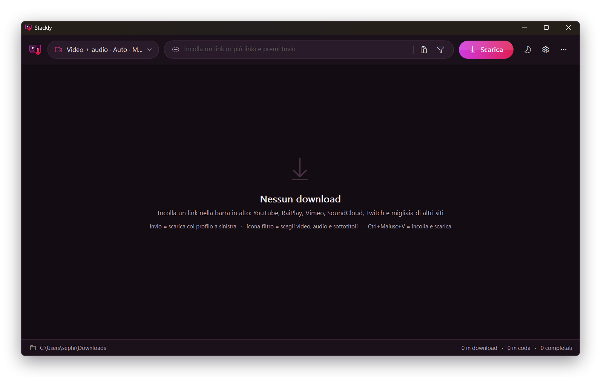

<p align="center">
  
</p>

<h1 align="center">Stackly</h1>

<p align="center">
  A lightweight Windows GUI for <b>yt-dlp</b>, inspired by Stacher and rebuilt from scratch.<br>
  Native Win32 C++17: a single <code>.exe</code>, no runtime to install.
</p>

<p align="center">
  <a href="https://github.com/Kyo89-sudo/Stackly/releases/latest"><b>Download the latest version</b></a>
  &nbsp;·&nbsp;
  <a href="CHANGELOG.md">Technical changelog</a>
  &nbsp;·&nbsp;
  <a href="https://github.com/Kyo89-sudo/Stackly/issues">Report a problem</a>
  &nbsp;·&nbsp;
  <a href="README.it.md">Italiano</a>
</p>

<p align="center">
  
</p>

<p align="center"><sub>The screenshot shows the Italian UI. Stackly is fully available in English: it switches automatically on English Windows, or pick it from the ⋯ menu → Lingua / Language.</sub></p>

## Features

- **Download video, audio and subtitles** from YouTube, Vimeo, SoundCloud, Twitch, RaiPlay, and every other site supported by yt-dlp.
- **Built-in segmented downloader**, no aria2 or other tools needed:
  - direct files are split into blocks and fetched over several HTTP connections in parallel;
  - interrupted downloads resume where they stopped;
  - HLS/DASH streams (Twitch, RaiPlay…) download fragments in parallel through yt-dlp;
  - several downloads at once, sharing a common connection limit.
- **Precise format picking**: resolution, codec, multiple audio tracks at once (e.g. original + audio description), original or auto-generated subtitles, even on their own.
- **MP4 or MKV**, audio as **MP3**, **M4A** or the original format. Audio and video are merged without re-encoding.
- **Light and dark theme**, following Windows or chosen manually.
- **English and Italian**: the language follows Windows, or pick it from menu ⋯ → Lingua / Language.
- **Notification area**: closing the window keeps downloads running, with a notice when they finish.
- **Self-updating tools**: downloads and updates yt-dlp, FFmpeg and Deno from the menu.

## Installation

From the [Releases](https://github.com/Kyo89-sudo/Stackly/releases/latest) page:

- **`StacklySetup-x.y.z.exe`**: installs for your user in `%LOCALAPPDATA%\Programs\Stackly`. No administrator rights needed; it creates shortcuts and can be uninstalled from *Settings → Apps → Installed apps*.
- **`Stackly-x.y.z-portable.zip`**: a single `Stackly.exe` to put anywhere. Settings and components stay in its folder (or in `%LOCALAPPDATA%\Stackly` if that folder is not writable).

Requirements: Windows 10 or 11, 64-bit. On first launch Stackly offers to download the missing components.

## Usage

1. Paste one or more links into the bar at the top and press **Enter** or **Download**.
2. The **profile** on the left decides what to download. The button sums up the active choices (e.g. `Video + audio · 1080p · MP4`) and opens the options menu.
3. The **Formats** icon inside the bar analyzes the link and lists every available format, so you can pick video, audio tracks and subtitles by hand.

### Download types

| Type | Options |
|---|---|
| **Video + audio** | quality (Auto, 4K … 360p, *Ask every time*), MP4/MKV container, subtitles in the video |
| **Video only** | quality, MP4/MKV container |
| **Audio only** | MP3 / M4A / original format, quality (best, 320, 192, 128 kbps) |
| **Subtitles only** | SRT or original format, optionally including auto-generated ones |
| **Choose every time** | opens the Formats window for each link |

Every type except *Choose every time* also has **Whole playlist**: if the link is a playlist or a channel, all its videos are downloaded.

With **Ask every time** Stackly shows only the resolutions actually available for that video, with the estimated size.

### Queue

- Each row shows thumbnail, progress, speed and time remaining.
- The icons on a row cancel, retry or open the folder, and remove the download from the list.
- Right-click also offers open file, copy URL and show in folder.
- **Retry** resumes segmented downloads where they stopped.

### Shortcuts

| Key | Action |
|---|---|
| `Ctrl+Shift+V` | paste from the clipboard and download right away |
| `Ctrl+O` | open the downloads folder |
| `Enter` (in the queue) | open the file |
| `Del` | remove the selected downloads |
| `Ctrl+A` / `Ctrl+C` | select all / copy the URLs |

## Components

| Component | Purpose |
|---|---|
| `yt-dlp.exe` | link extraction (required) |
| `ffmpeg.exe` + `ffprobe.exe` | audio/video merging, MP3, subtitles |
| `deno.exe` | JavaScript runtime used by yt-dlp for YouTube |

They are stored in Stackly's `bin\` folder and updated from the **⋯** menu; the *About* window shows the version and path of each one.

## Silent install

```
StacklySetup-x.y.z.exe /S                  silent install
StacklySetup-x.y.z.exe /S /D=C:\Path       silent install into a folder
uninstall.exe /uninstall /S                silent uninstall
```

## Building

Every build produces the app, the installer and the portable zip in `dist\`.

**Visual Studio 2019/2022**

```bat
build.bat
```

**llvm-mingw / MinGW-w64**, also from Linux:

```sh
./make_release.sh /path/to/llvm-mingw/bin/x86_64-w64-mingw32-
```

**CMake**

```bat
cmake -S . -B build -A x64
cmake --build build --config Release
```

The icon is regenerated with `python3 tools/make_icon.py` (Pillow + NumPy). Translations live in `tools/lang_en.json`: `python3 tools/i18n.py` regenerates `src/lang_table.inc` and reports any string without a translation. Portable tests are in `tests/`, for example:

```sh
g++ -std=c++17 -fsanitize=address,undefined tests/json_test.cpp -o json_test && ./json_test
```

## Project layout

```
src/main.cpp        main window, queue, notification area, menus
src/ui.h            theme, owner-drawn buttons, queue rows
src/dialogs.h       Formats, Resolution, Settings and About windows
src/engine.h        yt-dlp/ffmpeg processes, native engine, tools, analysis
src/net.h           WinHTTP segmented downloader, thumbnails (WIC)
src/json.h          JSON parser for the output of yt-dlp -J
src/app.h           types, palette, settings, utilities
src/lang.h          localization: TR(), language selection
src/lang_table.inc  Italian → English table (generated by tools/i18n.py)
installer/          StacklySetup (installer and uninstaller)
tools/              icon (make_icon.py) and translations (i18n.py, lang_en.json)
tests/              portable tests
docs/               screenshots
```

The source strings are written in Italian and translated through `TR()`; see `src/lang.h`.

## Version history

Click a version to see what changed. Technical details are in the [changelog](CHANGELOG.md).

<details>
<summary><b>0.6.1</b> — sharper icon, faster file creation</summary>

- The notification-area icon is sharp at every display scale and no longer looks blurry on a light taskbar.
- "Creating file…" is faster: merged MP4 files are no longer rewritten a second time.
- While a file is being created, an animated bar and the elapsed time show that work is in progress.

</details>

<details>
<summary><b>0.6.0</b> — English interface and GPL license</summary>

- **English interface**: follows the Windows language, or pick it from menu ⋯ → Lingua / Language (a restart is needed and Stackly offers it). The installer is in English too on non-Italian Windows.
- Stackly is now free software under the **GNU GPL v3.0**.
- The profile text at the top is no longer cut off.

</details>

<details>
<summary><b>0.5.3</b> — fixes and robustness</summary>

- With several downloads at once, a finished one could stay stuck on "Creating file…" until another one ended.
- Titles and names with unusual characters are no longer garbled.
- "Choose every time" and "Ask every time" on a playlist link answer right away.
- "Subtitles only" reports an error when there are no subtitles in the chosen languages.
- Cancel now works in the rare cases where it previously had no effect.
- An interrupted download without resume support is no longer reported as completed.
- No more sudden crashes if Windows runs out of resources for threads.
- Menu ⋯ → "Stackly on GitHub" and "Report a problem..."; project link in the About window.

</details>

<details>
<summary><b>0.5.2</b> — polished dialogs</summary>

- A single square checkbox style across the whole app (Settings, Formats window, lists).
- Rectangular fields and buttons in Settings, with a thin border that turns ruby when active.
- App-styled arrows on number fields; text and caret centered in the fields.
- If another copy of Stackly is already open from a different folder (for example an old version left in the notification area), Stackly offers to close it and start instead.

</details>

<details>
<summary><b>0.5.1</b> — dark theme in dialogs</summary>

- First app-drawn checkboxes and field borders, replacing the system ones that clashed with the dark theme.

</details>

<details>
<summary><b>0.5.0</b> — new interface, icon and download types</summary>

- **Stacher-style interface**: profile on the left, link bar in the middle, *Download* and icons on the right; queue rows with icons to cancel, retry, open the folder and remove; status bar with the destination folder.
- **New 3D "Ruby" icon** and **magenta → ruby palette**, with redesigned buttons and a calmer light theme.
- **Download types**: Video + audio, Video only, Audio only, Subtitles only, Choose every time. The profile menu shows only the options for the chosen type.
- **About window** with the status of yt-dlp, FFmpeg and Deno and buttons to update them.
- **More reliable segmented downloads**: truly separate connections, resume with "Retry" after an error, correct speed when resuming, instant cancel, partial files removed when a download is removed.
- Fixed accented characters in menus; the installer has the version in its name.

</details>

<details>
<summary><b>0.3</b> — calmer interface</summary>

- Nearly square corners, thin borders, more readable secondary text.
- Options with explicit labels (Type / Quality / Format).
- **Auto** and **Ask every time** quality, showing the resolutions actually available with the estimated size.

</details>

<details>
<summary><b>0.2</b> — formats, segmented downloads, dark theme</summary>

- Interface with video thumbnails, light/dark theme.
- **Formats window**: video, several audio tracks at once, subtitles even on their own, embedded or as files, SRT conversion.
- **MP4 / MKV** selectable.
- **Native segmented downloads**, without aria2: multiple connections per file, resume, several downloads at once.
- Notification area, single instance, installer.

</details>

## License

Stackly is free software, released under the [GNU GPL v3.0](LICENSE).
yt-dlp, FFmpeg and Deno are separate programs with their own licenses, downloaded separately.

## Notes

Please respect the terms of service of the sites you download from and copyright law. DRM-protected content cannot be downloaded.
